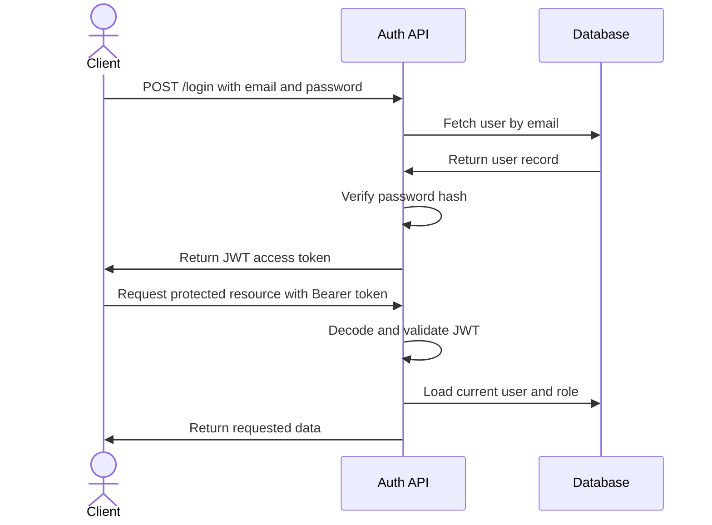
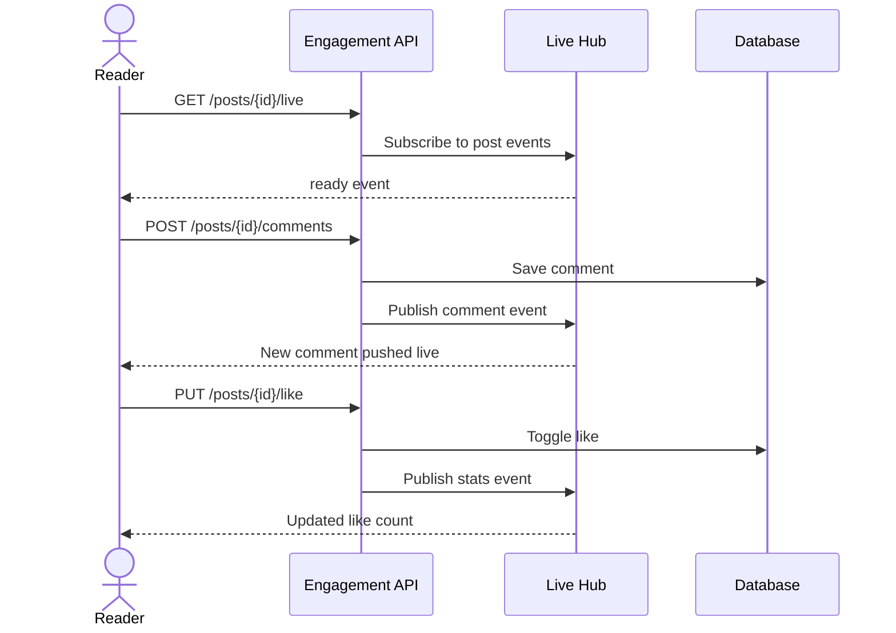

# News 24 API

A production-ready backend for a modern news and podcast platform. It gives editorial teams a clean admin interface for managing articles, podcasts, writers and categories, while giving readers a fast, searchable public feed with comments, likes, shares and real-time updates.

## Overview

News 24 helps teams run a digital publication from end to end. Writers and editors can draft, publish and organize articles and podcast episodes. Readers can browse the latest stories, search across categories, interact through comments and likes, and see live engagement updates as they happen.

The codebase is built around feature-based modules, so each domain, auth, users, posts, podcasts, writers, categories and engagement, keeps its own models, schemas, services and routes. That makes the project easy to extend without turning into a maze of cross-imports.

## System Architecture

```mermaid
flowchart LR
    Reader["Reader Client"]
    Editor["Editor Client"
    API["News 24 API"
    DB[("PostgreSQL Database")]
    Seed["Seed Data Files"]

    Reader --> API
    Editor --> API
    API --> DB
    Seed --> API

    style Reader fill:#1e1b4b,stroke:#6366f1,stroke-width:2px,color:#fff
    style Editor fill:#1e1b4b,stroke:#6366f1,stroke-width:2px,color:#fff
    style API fill:#2e1065,stroke:#8b5cf6,stroke-width:2px,color:#fff
    style DB fill:#0f172a,stroke:#3b82f6,stroke-width:2px,color:#fff
    style Seed fill:#022c22,stroke:#10b981,stroke-width:2px,color:#fff
```

## Features

- **Editorial content management** - Admins can create, edit and publish posts and podcasts, assign writers, add categories and manage URL slugs.
- **Role-based access control** - Two built-in roles, `user` and `admin`, enforced through reusable dependencies. Admins manage content and users; regular users read and engage.
- **Search and pagination** - Public post listings support full-text search across titles, excerpts and bodies, plus filtering by category or writer, with `X-Total-Count` headers for pagination.
- **Real-time engagement** - Readers can comment, like posts and comments, share posts and subscribe to a live Server-Sent Events stream for instant updates.
- **Secure authentication** - OAuth2 password flow with JWT access tokens, Argon2 password hashing and a complete forgot-password flow using single-use hashed reset tokens.
- **Alembic migrations and seed data** - Database schema is versioned with Alembic, and sample writers, posts, podcasts and categories can be loaded with one command.

### Authentication Flow



### Live Engagement Flow



## Installation

Clone the repository and move into the project folder.

```bash
git clone git@github.com:philtechphilips/news-24-blog.git
cd news-24-blog
```

Create and activate a virtual environment, then install dependencies with `uv`.

```bash
uv sync
```

Copy the example environment file and fill in your own values.

```bash
cp .env.example .env
```

Your `.env` should look something like this:

```ini
PROJECT_NAME="News 24"
DATABASE_HOSTNAME=localhost
DATABASE_PORT=5432
DATABASE_NAME=news24
DATABASE_USERNAME=postgres
DATABASE_PASSWORD=your_secure_password
SECRET_KEY=your_super_secret_key
ACCESS_TOKEN_EXPIRE_MINUTES=30
PASSWORD_RESET_TOKEN_EXPIRE_MINUTES=30
FRONTEND_URL=http://localhost:3000
CORS_ORIGINS=["http://localhost:3000"]
```

Run the migrations to create the database tables.

```bash
uv run poe migrate
```

Seed the database with sample writers, categories, posts and podcasts.

```bash
uv run poe seed
```

Start the development server.

```bash
uv run poe dev
```

Open the interactive docs at [http://127.0.0.1:8000/docs](http://127.0.0.1:8000/docs).

## Usage

Create the first admin account from the terminal.

```bash
uv run poe createadmin admin@example.com
```

The command will prompt for a password and create an admin user if the email does not exist.

Once the server is running, you can interact with the API using the built-in Swagger UI, or with curl. Here is how to log in and fetch the current user.

```bash
# Log in and get an access token
curl -X POST "http://127.0.0.1:8000/login" \
  -H "Content-Type: application/x-www-form-urlencoded" \
  -d "username=admin@example.com&password=your_password"
```

The response will look like this:

```json
{
  "access_token": "<access_token>",
  "token_type": "bearer"
}
```

Use the token to hit a protected endpoint.

```bash
curl -X GET "http://127.0.0.1:8000/users/me" \
  -H "Authorization: Bearer <access_token>"
```

## API Documentation

Authentication uses OAuth2 Bearer tokens. Obtain a token from `POST /login` and send it in the `Authorization: Bearer <token>` header for protected routes.

### Authentication

#### POST /login
Log in with email and password and receive a JWT access token.

**Request:**
```json
{
  "grant_type": "password",
  "username": "admin@example.com",
  "password": "<password>"
}
```

**Response:**
```json
{
  "access_token": "<access_token>",
  "token_type": "bearer"
}
```

**Errors:**
- 401: Invalid credentials

#### POST /forgot-password
Request a password reset link. Always returns the same message to avoid leaking registered emails.

**Request:**
```json
{
  "email": "admin@example.com"
}
```

**Response:**
```json
{
  "message": "If an account exists for that email, a reset link has been sent"
}
```

#### POST /reset-password
Reset a password using a valid reset token.

**Request:**
```json
{
  "token": "abcd1234...",
  "new_password": "<new_password>"
}
```

**Response:**
```json
{
  "message": "Password has been reset"
}
```

**Errors:**
- 400: Invalid or expired reset token

### Users

#### POST /users/
Register a new user account. New accounts are always created with the `user` role.

**Request:**
```json
{
  "email": "reader@example.com",
  "password": "SecurePassword123",
  "name": "Jane Reader"
}
```

**Response:**
```json
{
  "id": "a1b2c3d4...",
  "email": "reader@example.com",
  "name": "Jane Reader",
  "role": "user",
  "created_at": "2026-01-01T00:00:00Z"
}
```

**Errors:**
- 409: Email already exists

#### GET /users/me
Get the currently authenticated user.

**Response:**
```json
{
  "id": "a1b2c3d4...",
  "email": "reader@example.com",
  "name": "Jane Reader",
  "role": "user",
  "created_at": "2026-01-01T00:00:00Z"
}
```

#### PATCH /users/me
Update the current user's display name.

**Request:**
```json
{
  "name": "Jane R."
}
```

**Response:**
```json
{
  "id": "a1b2c3d4...",
  "email": "reader@example.com",
  "name": "Jane R.",
  "role": "user",
  "created_at": "2026-01-01T00:00:00Z"
}
```

#### GET /users/
List all users. Admin only.

**Response:**
```json
[
  {
    "id": "a1b2c3d4...",
    "email": "reader@example.com",
    "name": "Jane Reader",
    "role": "user",
    "created_at": "2026-01-01T00:00:00Z"
  }
]
```

#### GET /users/admins
List all admin users. Admin only.

**Response:**
```json
[
  {
    "id": "a1b2c3d4...",
    "email": "admin@example.com",
    "name": "Admin User",
    "role": "admin",
    "created_at": "2026-01-01T00:00:00Z"
  }
]
```

#### POST /users/admins
Create a new user account with admin role. Admin only.

**Request:**
```json
{
  "email": "newadmin@example.com",
  "password": "SecurePassword123",
  "name": "New Admin"
}
```

**Response:**
```json
{
  "id": "b2c3d4e5...",
  "email": "newadmin@example.com",
  "name": "New Admin",
  "role": "admin",
  "created_at": "2026-01-01T00:00:00Z"
}
```

#### PUT /users/{user_id}/admin
Promote an existing user to admin. Admin only.

**Response:**
```json
{
  "id": "a1b2c3d4...",
  "email": "reader@example.com",
  "name": "Jane Reader",
  "role": "admin",
  "created_at": "2026-01-01T00:00:00Z"
}
```

**Errors:**
- 400: Cannot modify your own role

#### DELETE /users/{user_id}/admin
Demote an admin back to regular user. Admin only.

**Response:**
```json
{
  "id": "a1b2c3d4...",
  "email": "reader@example.com",
  "name": "Jane Reader",
  "role": "user",
  "created_at": "2026-01-01T00:00:00Z"
}
```

**Errors:**
- 400: Cannot remove your own admin rights

#### GET /users/{user_id}
Get a specific user by ID. Users can view themselves; admins can view anyone.

**Response:**
```json
{
  "id": "a1b2c3d4...",
  "email": "reader@example.com",
  "name": "Jane Reader",
  "role": "user",
  "created_at": "2026-01-01T00:00:00Z"
}
```

**Errors:**
- 403: Insufficient permissions
- 404: User not found

#### PATCH /users/{user_id}/role
Update a user's role. Admin only.

**Request:**
```json
{
  "role": "admin"
}
```

**Response:**
```json
{
  "id": "a1b2c3d4...",
  "email": "reader@example.com",
  "name": "Jane Reader",
  "role": "admin",
  "created_at": "2026-01-01T00:00:00Z"
}
```

**Errors:**
- 400: Cannot change your own role

#### DELETE /users/{user_id}
Permanently delete a user account. Admin only.

**Errors:**
- 400: Cannot delete your own account
- 404: User not found

### Categories

#### POST /categories/
Create a new category. Admin only.

**Request:**
```json
{
  "name": "Technology"
}
```

**Response:**
```json
{
  "id": "c3d4e5f6...",
  "name": "Technology",
  "created_at": "2026-01-01T00:00:00Z",
  "updated_at": "2026-01-01T00:00:00Z"
}
```

**Errors:**
- 409: Category already exists

#### GET /categories/
List all categories.

**Response:**
```json
[
  {
    "id": "c3d4e5f6...",
    "name": "Technology",
    "created_at": "2026-01-01T00:00:00Z",
    "updated_at": "2026-01-01T00:00:00Z"
  }
]
```

#### GET /categories/{category_id}
Get a specific category by ID.

**Response:**
```json
{
  "id": "c3d4e5f6...",
  "name": "Technology",
  "created_at": "2026-01-01T00:00:00Z",
  "updated_at": "2026-01-01T00:00:00Z"
}
```

**Errors:**
- 404: Category not found

#### PATCH /categories/{category_id}
Update a category name. Admin only.

**Request:**
```json
{
  "name": "Tech"
}
```

**Response:**
```json
{
  "id": "c3d4e5f6...",
  "name": "Tech",
  "created_at": "2026-01-01T00:00:00Z",
  "updated_at": "2026-01-01T00:00:00Z"
}
```

**Errors:**
- 409: Category name already exists
- 404: Category not found

#### DELETE /categories/{category_id}
Delete a category. Admin only.

**Errors:**
- 404: Category not found

### Posts

#### GET /posts/
List published posts. Public endpoint. Supports pagination and search.

**Query parameters:**
- `category_id` (optional): Filter by category UUID
- `writer_id` (optional): Filter by writer UUID
- `q` (optional): Search text
- `limit` (default 20, max 100)
- `skip` (default 0)

**Response:**
```json
[
  {
    "id": "d4e5f6g7...",
    "title": "Tech Giants Unveil Next Generation AI Assistants",
    "slug": "tech-giants-unveil-next-generation-ai-assistants",
    "body": "Full article body...",
    "excerpt": "The biggest names in technology...",
    "featured_image": "https://example.com/image.jpg",
    "tags": ["AI", "Technology"],
    "is_published": true,
    "category_id": "c3d4e5f6...",
    "writer_id": "e5f6g7h8...",
    "created_at": "2026-10-21T09:00:00Z",
    "updated_at": "2026-10-21T09:00:00Z"
  }
]
```

Response headers include `X-Total-Count` with the total number of matching posts.

#### GET /posts/all
List all posts including drafts. Admin only.

**Response:**
```json
[
  {
    "id": "d4e5f6g7...",
    "title": "Draft Post Title",
    "slug": "draft-post-title",
    "body": "Draft body...",
    "excerpt": null,
    "featured_image": null,
    "tags": [],
    "is_published": false,
    "category_id": null,
    "writer_id": null,
    "created_at": "2026-01-01T00:00:00Z",
    "updated_at": "2026-01-01T00:00:00Z"
  }
]
```

#### GET /posts/slug/{slug}
Get a published post by slug. Public endpoint.

**Response:**
```json
{
  "id": "d4e5f6g7...",
  "title": "Tech Giants Unveil Next Generation AI Assistants",
  "slug": "tech-giants-unveil-next-generation-ai-assistants",
  "body": "Full article body...",
  "excerpt": "The biggest names in technology...",
  "featured_image": "https://example.com/image.jpg",
  "tags": ["AI", "Technology"],
  "is_published": true,
  "category_id": "c3d4e5f6...",
  "writer_id": "e5f6g7h8...",
  "created_at": "2026-10-21T09:00:00Z",
  "updated_at": "2026-10-21T09:00:00Z"
}
```

**Errors:**
- 404: Post not found

#### GET /posts/{post_id}
Get a specific post by ID. Admin only.

**Response:**
```json
{
  "id": "d4e5f6g7...",
  "title": "Tech Giants Unveil Next Generation AI Assistants",
  "slug": "tech-giants-unveil-next-generation-ai-assistants",
  "body": "Full article body...",
  "excerpt": "The biggest names in technology...",
  "featured_image": "https://example.com/image.jpg",
  "tags": ["AI", "Technology"],
  "is_published": true,
  "category_id": "c3d4e5f6...",
  "writer_id": "e5f6g7h8...",
  "created_at": "2026-10-21T09:00:00Z",
  "updated_at": "2026-10-21T09:00:00Z"
}
```

#### POST /posts/
Create a new post. Admin only.

**Request:**
```json
{
  "title": "My New Article",
  "body": "Article content here...",
  "slug": "my-new-article",
  "excerpt": "A short summary",
  "featured_image": "https://example.com/image.jpg",
  "tags": ["news", "tech"],
  "is_published": true,
  "category_id": "c3d4e5f6...",
  "writer_id": "e5f6g7h8..."
}
```

**Response:**
```json
{
  "id": "d4e5f6g7...",
  "title": "My New Article",
  "slug": "my-new-article",
  "body": "Article content here...",
  "excerpt": "A short summary",
  "featured_image": "https://example.com/image.jpg",
  "tags": ["news", "tech"],
  "is_published": true,
  "category_id": "c3d4e5f6...",
  "writer_id": "e5f6g7h8...",
  "created_at": "2026-01-01T00:00:00Z",
  "updated_at": "2026-01-01T00:00:00Z"
}
```

**Errors:**
- 409: Slug already exists
- 422: Referenced category or writer does not exist

#### PATCH /posts/{post_id}
Update a post. Admin only.

**Request:**
```json
{
  "title": "Updated Article Title",
  "is_published": true
}
```

**Response:**
```json
{
  "id": "d4e5f6g7...",
  "title": "Updated Article Title",
  "slug": "my-new-article",
  "body": "Article content here...",
  "excerpt": "A short summary",
  "featured_image": "https://example.com/image.jpg",
  "tags": ["news", "tech"],
  "is_published": true,
  "category_id": "c3d4e5f6...",
  "writer_id": "e5f6g7h8...",
  "created_at": "2026-01-01T00:00:00Z",
  "updated_at": "2026-01-01T00:00:00Z"
}
```

#### DELETE /posts/{post_id}
Delete a post. Admin only.

**Errors:**
- 404: Post not found

### Podcasts

#### GET /podcasts/
List published podcast episodes. Public endpoint.

**Response:**
```json
[
  {
    "id": "e5f6g7h8...",
    "title": "The Future of Work with AI",
    "slug": "future-of-work-with-ai",
    "description": "What AI assistants will change about our jobs...",
    "cover_image": "https://example.com/cover.jpg",
    "audio_url": "https://example.com/audio.mp3",
    "duration_minutes": 47,
    "topics": ["AI", "Careers", "Productivity"],
    "notes": ["Which tasks AI handles well today..."],
    "is_published": true,
    "host_id": "f6g7h8i9...",
    "created_at": "2026-09-09T09:00:00Z",
    "updated_at": "2026-09-09T09:00:00Z"
  }
]
```

#### GET /podcasts/all
List all podcast episodes including drafts. Admin only.

#### GET /podcasts/slug/{slug}
Get a published podcast by slug. Public endpoint.

**Response:**
```json
{
  "id": "e5f6g7h8...",
  "title": "The Future of Work with AI",
  "slug": "future-of-work-with-ai",
  "description": "What AI assistants will change about our jobs...",
  "cover_image": "https://example.com/cover.jpg",
  "audio_url": "https://example.com/audio.mp3",
  "duration_minutes": 47,
  "topics": ["AI", "Careers", "Productivity"],
  "notes": ["Which tasks AI handles well today..."],
  "is_published": true,
  "host_id": "f6g7h8i9...",
  "created_at": "2026-09-09T09:00:00Z",
  "updated_at": "2026-09-09T09:00:00Z"
}
```

#### GET /podcasts/{podcast_id}
Get a specific podcast by ID. Admin only.

#### POST /podcasts/
Create a new podcast episode. Admin only.

**Request:**
```json
{
  "title": "Inside the Newsroom",
  "description": "How a story gets made.",
  "slug": "inside-the-newsroom",
  "cover_image": "https://example.com/cover.jpg",
  "audio_url": "https://example.com/audio.mp3",
  "duration_minutes": 52,
  "topics": ["Journalism", "Editing"],
  "notes": ["How editors decide which stories to pursue."],
  "is_published": true,
  "host_id": "f6g7h8i9..."
}
```

**Response:**
```json
{
  "id": "e5f6g7h8...",
  "title": "Inside the Newsroom",
  "slug": "inside-the-newsroom",
  "description": "How a story gets made.",
  "cover_image": "https://example.com/cover.jpg",
  "audio_url": "https://example.com/audio.mp3",
  "duration_minutes": 52,
  "topics": ["Journalism", "Editing"],
  "notes": ["How editors decide which stories to pursue."],
  "is_published": true,
  "host_id": "f6g7h8i9...",
  "created_at": "2026-01-01T00:00:00Z",
  "updated_at": "2026-01-01T00:00:00Z"
}
```

#### PATCH /podcasts/{podcast_id}
Update a podcast episode. Admin only.

#### DELETE /podcasts/{podcast_id}
Delete a podcast episode. Admin only.

### Writers

#### GET /writers/
List all writer profiles. Public endpoint.

**Response:**
```json
[
  {
    "id": "f6g7h8i9...",
    "name": "Daniel Okafor",
    "slug": "daniel-okafor",
    "role": "Tech Correspondent",
    "avatar": "https://example.com/avatar.jpg",
    "location": "San Francisco, USA",
    "joined": "2022-04-03",
    "bio": ["Daniel covers artificial intelligence..."],
    "beats": ["Technology", "AI", "Security"],
    "social": {
      "x": "https://x.com",
      "linkedin": "https://linkedin.com"
    },
    "created_at": "2026-01-01T00:00:00Z",
    "updated_at": "2026-01-01T00:00:00Z"
  }
]
```

#### GET /writers/slug/{slug}
Get a writer by slug. Public endpoint.

#### GET /writers/{writer_id}
Get a writer by ID. Public endpoint.

#### POST /writers/
Create a new writer profile. Admin only.

**Request:**
```json
{
  "name": "Sarah Smith",
  "role": "Senior Editor",
  "slug": "sarah-smith",
  "avatar": "https://example.com/avatar.jpg",
  "location": "New York, USA",
  "joined": "2020-01-15",
  "bio": ["Sarah has covered politics for over a decade."],
  "beats": ["Politics", "Policy"],
  "social": {
    "x": "https://x.com",
    "linkedin": "https://linkedin.com"
  }
}
```

#### PATCH /writers/{writer_id}
Update a writer profile. Admin only.

#### DELETE /writers/{writer_id}
Delete a writer profile. Admin only.

### Engagement

#### GET /posts/{post_id}/engagement
Get the full engagement state for a post: stats, all comments and the current viewer's likes. Public endpoint.

**Response:**
```json
{
  "stats": {
    "likes": 42,
    "comments": 7,
    "shares": 12
  },
  "comments": [
    {
      "id": "g7h8i9j0...",
      "post_id": "d4e5f6g7...",
      "parent_id": null,
      "body": "Great article!",
      "created_at": "2026-01-01T00:00:00Z",
      "author": {
        "id": "a1b2c3d4...",
        "name": "Jane Reader"
      },
      "likes": 3
    }
  ],
  "liked": false,
  "liked_comments": []
}
```

#### GET /posts/{post_id}/live
Subscribe to a Server-Sent Events stream for real-time updates on a post. Public endpoint.

Events include:
- `ready`: Sent when connecting or falling behind
- `comment`: New comment or reply
- `comment_removed`: Comment and its replies were deleted
- `comment_like`: A comment like changed
- `post_like`: A post like changed
- `stats`: Post stats updated

#### POST /posts/{post_id}/comments
Add a comment or reply on a published post. Requires authentication.

**Request:**
```json
{
  "body": "Great article!",
  "parent_id": null
}
```

**Response:**
```json
{
  "id": "g7h8i9j0...",
  "post_id": "d4e5f6g7...",
  "parent_id": null,
  "body": "Great article!",
  "created_at": "2026-01-01T00:00:00Z",
  "author": {
    "id": "a1b2c3d4...",
    "name": "Jane Reader"
  },
  "likes": 0
}
```

**Errors:**
- 404: Post not found or not published
- 422: Parent comment does not exist

#### DELETE /comments/{comment_id}
Delete a comment and all its replies. Requires authentication. Authors and admins only.

**Errors:**
- 403: Can only delete your own comments
- 404: Comment not found

#### PUT /posts/{post_id}/like
Like a published post. Requires authentication.

**Response:**
```json
{
  "liked": true,
  "likes": 43
}
```

#### DELETE /posts/{post_id}/like
Unlike a published post. Requires authentication.

**Response:**
```json
{
  "liked": false,
  "likes": 42
}
```

#### PUT /comments/{comment_id}/like
Like a comment. Requires authentication.

#### DELETE /comments/{comment_id}/like
Unlike a comment. Requires authentication.

#### POST /posts/{post_id}/share
Record a share for a published post. Public endpoint.

**Response:**
```json
{
  "likes": 42,
  "comments": 7,
  "shares": 13
}
```

## Environment Variables

| Variable | Description | Example |
|----------|-------------|---------|
| `PROJECT_NAME` | Display name of the application | `News 24` |
| `DATABASE_HOSTNAME` | PostgreSQL host | `localhost` |
| `DATABASE_PORT` | PostgreSQL port | `5432` |
| `DATABASE_NAME` | Database name | `news24` |
| `DATABASE_USERNAME` | Database username | `postgres` |
| `DATABASE_PASSWORD` | Database password | `your_secure_password` |
| `SECRET_KEY` | Key for signing JWTs | `super_secret_key` |
| `ALGORITHM` | JWT algorithm | `HS256` |
| `ACCESS_TOKEN_EXPIRE_MINUTES` | JWT expiration time | `30` |
| `PASSWORD_RESET_TOKEN_EXPIRE_MINUTES` | Reset token expiration time | `30` |
| `FRONTEND_URL` | Frontend URL for password reset links | `http://localhost:3000` |
| `CORS_ORIGINS` | Allowed CORS origins as JSON list | `["http://localhost:3000"]` |

## Technologies Used

| Technology | Purpose |
|------------|---------|
| [FastAPI](https://fastapi.tiangolo.com/) | Web framework and API |
| [SQLAlchemy 2.0](https://www.sqlalchemy.org/) | ORM and database models |
| [Pydantic](https://docs.pydantic.dev/) | Data validation and settings |
| [PostgreSQL](https://www.postgresql.org/) | Primary database |
| [Alembic](https://alembic.sqlalchemy.org/) | Database migrations |
| [PyJWT](https://pyjwt.readthedocs.io/) | JWT token handling |
| [pwdlib](https://pypi.org/project/pwdlib/) | Password hashing with Argon2 and bcrypt |
| [pytest](https://docs.pytest.org/) | Testing framework |
| [ruff](https://docs.astral.sh/ruff/) | Linting and formatting |
| [uv](https://docs.astral.sh/uv/) | Python package and project management |
| [poethepoet](https://poethepoet.natn.io/) | Task runner |

## Contributing

Contributions are welcome. If you want to add a feature, fix a bug or improve the documentation, please open an issue first so we can agree on the approach. Keep changes focused, write tests for new behavior, and make sure the existing test suite still passes.

```bash
uv run poe check
```

## Author

- LinkedIn: [Pelumi Isola](https://linkedin.com/in/Pelumi Isola)
- X (Twitter): [@softwareengng](https://x.com/softwareengng)

## Badges

[](https://www.python.org/)
[](https://fastapi.tiangolo.com/)
[](https://www.sqlalchemy.org/)
[](https://www.postgresql.org/)
[](https://docs.pydantic.dev/)
[](https://docs.pytest.org/)
[](https://docs.astral.sh/ruff/)
[](https://docs.astral.sh/uv/)

[](https://dokugen.samueltuoyo.com)